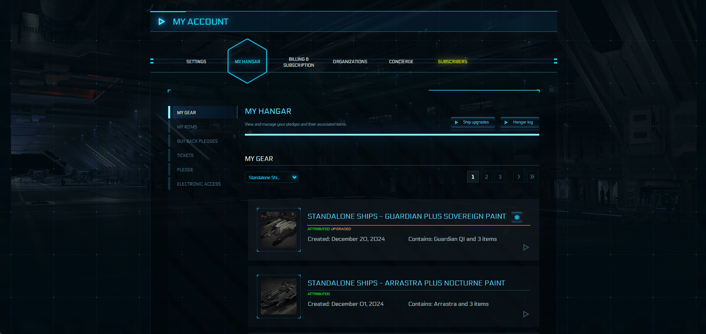
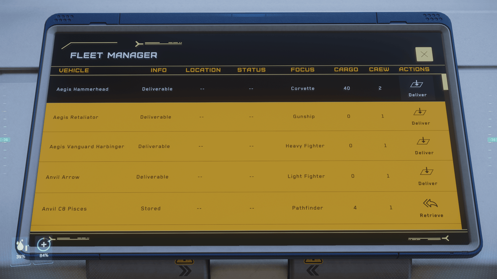
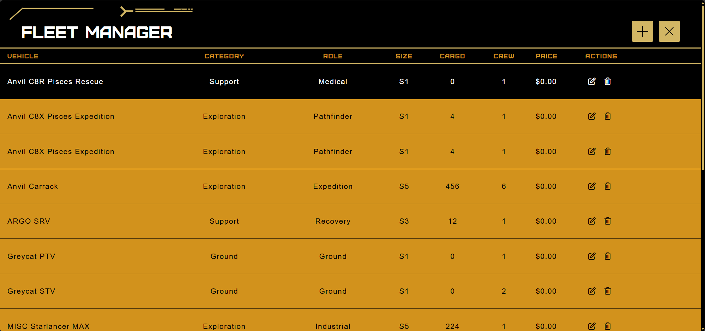
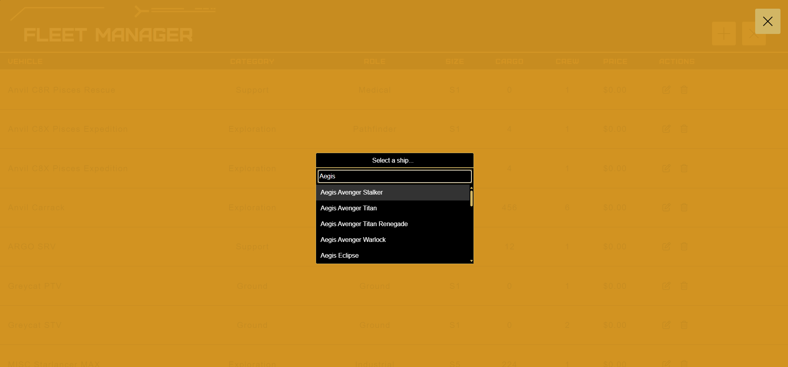

# ASOP App: A Star Citizen Tool

## Overview

ASOP App is a web-based fleet management tool that faithfully recreates Star Citizen's in-game ASOP Terminal interface while adding helpful features for organizing ships and vehicles outside of the game. The app aims to fill a crucial gap in the Star Citizen community by providing a user-friendly interface for managing fleets and ship data that players have come to know and love from the game itself.

## Case Study

The ASOP Terminal is a crucial interface in Star Citizen which allows the players to manage their ships and vehicles within the game. While Cloud Imperium Games (CIG), the developers behind Star Citizen, offers the ASOP in game, players have to resort to 3rd party applications, websites and even Excel spreadsheets to manage their fleet.

The ASOP App that I created is my official step into this space of insanely great talent to help players manage their fleets outside of the game. The main inspiration was to faithfully recreate the main UI of the ASOP terminal in game and offer it as a web based application so all players can access it on all devices while also including some custom features.

Pictured below is what CIG currently offers as a way to view your fleet, if you can even say that. CIG has made strides recently to update their website UI and UX but unfortunately it seems that the player pages have not been graced with said updates.

*The `My Hangar` tab on the official website.*

As you can see the UI is pretty simple and not very user friendly for a modern audience as it is stuck in the mid 2010's of web design. Users cannot search, filter or sort their ships and vehicles in any way. The only way to see what you have is to scroll through the list and hope you remember what you have.

*The ASOP Terminal in game.*

Above is a picture of the ASOP Terminal in the game as of 4.0 (EOY 2024 / BOY 2025). The UI is basic in a good way as it is easy to navigate and understand, whether you are a brand new player, a veteran player or a player who has taken a break from the game.

The terminal shows the players all ships and vehicles, along with some important information divided up into columns such as Vehicle (Manufacturer and Name), current status of the ship (Delivered, Stored, Deliverable), Location, Status, Focus, Cargo and Crew.

My goal was to recreate this UI as faithfully as possible while also adding some custom features that I thought would be useful to players. However, some details like current status, location, and the deliver/retrieve/claim actions would be left behind as there would be no point to bring it over.

*The ASOP App web app.*

Pictured above is my faithful recreation of the app along with the new columns that would make more sense for a web based fleet manager such as an expanded category and sub category, ship component size, cargo, crew, price, and a edit / delete icon.

The in game version has an X at the top left that allows you to close the terminal and return to your business, however, it now serves as a menu icon that allows players to manage settings, logout and see their profile. To add a ship, I simply created a new icon to the left which opens up another overlay to add a ship.

*The ASOP App add ship overlay.*

Using the popular Select2 library, I was able to add a search box to filter down manufacturers and ships as Star Citizen has over 100 ships and vehicles to choose from. The only restriction currently in the list are ships that have not been released which I intend to talk about later on.

### Conclusion

Overall, I am very happy with how the app turned out. I was able to recreate the UI of the ASOP Terminal in game and add some custom features that I thought would be useful to players. I have been using the app myself to manage my fleet and it has been a great experience to do so, coming from an Excel Spreadsheet.

If you have any feedback or suggestions, please feel free to reach out to me on Discord or X, @NoahFlowa

## Future Features

While the app is currently in a usable state, there are some features that I would like to add in the future as well as some redesigns.

Currently the UI is very basic outside of the ASOP Terminal screen seen in game. My goal for this project was to get it built and get it shipped, as most Software Developers can relate to, doing so and not letting it sit is a very challenging task.

The UI I'd like to redesign are:

- Sign in and Sign up
- The overlays for both the main menu and the add a ship menu
- The ship/vehicle search fields

Features I'd like to add are:

- Versioning Info and Last Updated Info
- Ship/Vehicle JSON Import from popular ship managers such as [Hangar Link](https://hangar.link/pledges/all), [CCU Game App](https://ccugame.app/), and [StarJump Fleet Viewer](https://hangar.link/fleet/canvas).
- Ship/Vehicle JSON Export
- Account Delete

## Technologies Used

- Adobe ColdFusion 2023 / Lucee 6
- Bootstrap 5.3
- Font Awesome 6.7
- Google Fonts
- MySQL
- Coolify
- Let's Encrypt
- Docker

## Links

[asop.app](https://asop.app)
