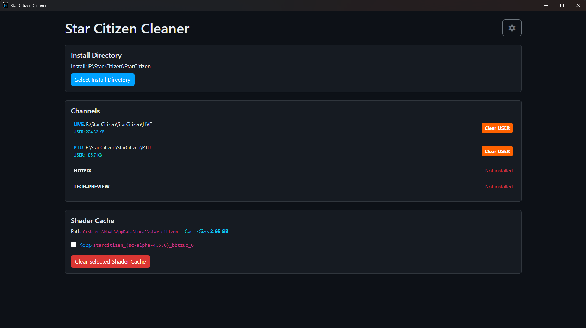

# Star Citizen Cleaner (SCCleaner.com)

## Overview

Star Citizen Cleaner (SCCleaner.com) is a simple easy to use tool to clean up user config files and shader cache files for the video game Star Citizen.

## Case Study

Star Citizen is a crowdfunded MMO first person universe simulator game developed by Cloud Imperium Games and published by Roberts Space Industries. Set in a sci-fi universe 930 years in the future, it features a sandbox with planetary systems to explore and careers like trading, combat, and mining.

The SCCleaner app that I created aims to help users easily remove older shader cache files that build up over the different version of the game as well as deleting user config files except keybinds and characters. These actions are recommended by CIG but aren't built into their launcher yet.

SCCleaner app features an easy to use UI/UX that asks the user for the main game install path then searches all installed game versions called channels as well as the local app data folder. From there the user can view full paths, sizes and take actions. SCCleaner also features an auto update function.

*The `SC Cleaner` app.*

The UI is insanely simple but that simplicity makes it very user friendly and easy to navigate. In that simplicity lies its strength.

## Future Features

The app is currently in a very usable state with auto updating and auto checking and strong fail protection in case of path errors.

Features I'd like to add are:

- Copyright Data as well as the Star Citizen disclaimer that its not directly affiliated with Cloud Imperium Games
- More detailed logging of actions taken
- Ability to back up config files before deletion

## Technologies Used

- Node JS
- Bootstrap 5.3
- Font Awesome 6.7
- Electron
- Electron Forge
- Coolify
- GitHub Releases
- Docker

## Links

[sccleaner.com](https://sccleaner.com)
